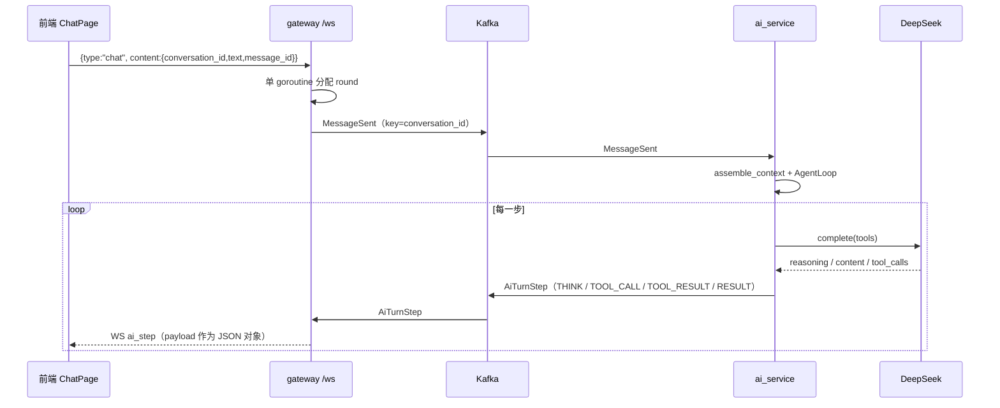

# 消息链路与字段传递文档

> 本文档描述**当前代码实际运行**的链路：前端 → gateway → Kafka → ai_service → Kafka → gateway → 前端。
>
> 当前没有消息落库：storage 尚未实现。存储现状见 [storage-architecture.md](./storage-architecture.md)。
>
> 2026-11 起 AI 输出统一为 **AiTurnStep（step 流）**，旧的 `AiReplyDelta` / `AiReplyGenerated` 已删除。

## 1. 总链路



- 一轮 = 用户一条消息 + AI 从开始处理到最终 RESULT；
- 轮内每一步完成就发一条 `AiTurnStep`，前端收到一段渲染一段；
- 没有 token 级流式；step 流提供“正在做什么”的可见性。

## 2. 前端 → gateway（WebSocket）

```json
{
  "type": "chat",
  "content": {
    "conversation_id": "AI 会话 ID",
    "text": "消息文本",
    "message_id": "客户端生成的 UUID",
    "message_type": "text"
  }
}
```

| 字段 | 说明 |
|---|---|
| `type` | `chat` / `ping` |
| `content.conversation_id` | 为空时 gateway 生成 UUID |
| `content.text` | 正文；为空丢弃 |
| `content.message_id` | 为空时 gateway 生成 UUID |
| `content.message_type` | 默认 `text` |

前端发送后本地乐观追加用户消息；gateway 不回推用户消息。

## 3. gateway（chat_service）

路由：

| 接口 | 说明 |
|---|---|
| `GET /api/v1/health` | 健康检查 |
| `GET /api/v1/users/:user_id` | 代理 auth_service |
| `POST /api/v1/conversations` | 返回一个新 UUID，不落库 |
| `GET /api/v1/ws` | WebSocket |

收到 `chat` 后：

1. `HandleChat` 只校验非空，然后提交给 `RoundAllocator`；
2. `RoundAllocator` 是一个 goroutine，独占 `map[conversation_id]round`；
3. 它在同一个串行段里分配 `round` 并发送 `MessageSent`，保证 round 顺序 = Kafka 顺序；
4. Kafka key = `conversation_id`。

gateway 不写数据库；round 表在内存，单实例有效，重启归零。

## 4. Kafka

Topic：`chat_group_message`。

| 事件 | 生产者 | 消费者 | 作用 |
|---|---|---|---|
| `chant.chat.v1.MessageSent` | gateway | ai_service | 用户消息，开启一轮 |
| `chant.chat.v1.AiTurnStep` | ai_service | gateway | AI 的每一步 |

分区 key：

- `MessageSent`：`conversation_id`
- `AiTurnStep`：`conversation_id`

信封见 [envelope.proto](../proto/chant/common/v1/envelope.proto)：`event_id`、`event_type`、`source`、`timestamp`、`data`。

## 5. MessageSent

定义见 [event.proto](../proto/chant/chat/v1/event.proto)。

| 字段 | 说明 |
|---|---|
| `sender_id` | 发送者用户 ID |
| `target_user_id` | AI 用户 ID |
| `conversation_id` | 会话 ID |
| `content` | 正文 |
| `message_id` | 用户消息 ID |
| `message_type` | `text` 等 |
| `round` | 第几轮，gateway 分配 |

## 6. ai_service 消费

[main.py](../services/ai_service/main.py)：

- consumer group：`ai_service_group`；
- 拉取/处理解耦：有界队列 + `ai_worker_count` 个 worker；
- 同一 `conversation_id` 串行，不同会话并行；
- 只处理 `MessageSent`，且 `target_user_id == settings.ai_user_id`。

[apps/chat/service.py](../services/ai_service/apps/chat/service.py)：

1. 从 MessageSent 取 `sender_id`、`conversation_id`、`content`、`message_id`、`round`；
2. 建 `Toolbox`，拼 system prompt + 工具目录；
3. `assemble_context` 组装上下文（当前 history 为空）；
4. `AgentLoop(..., on_step=on_step)`；
5. 每产生一步，`on_step` 把 `AiTurnStep` 发到 Kafka（key=conversation_id）。

## 7. AgentLoop 与 step

[loop.py](../services/ai_service/runtime/agent_loop/loop.py)：

```
model.complete(messages, tools)
  ├─ reasoning 非空       → THINK
  ├─ 有 tool_calls        → TOOL_CALL → 执行工具 → TOOL_RESULT → 继续
  └─ 无 tool_calls        → RESULT（本轮结束）
```

step 类型：

| kind | 含义 | payload |
|---|---|---|
| `THINK` | 思考 | `{"think": "..."}` |
| `TOOL_CALL` | 工具调用 | `{"calls":[{"id","name","input"}]}` |
| `TOOL_RESULT` | 工具返回 | `{"results":[{"id","name","payload","status","duration_ms","error"}]}` |
| `RESULT` | 最终回答 + 终止 | `{"result","status","reason"}` |

- 一批工具 = 一个 TOOL_CALL + 一个 TOOL_RESULT；
- 工具执行过程本身不发事件；
- 工具返回是独立一步，必须能独立展示；
- 工具结果沿用 `max_tool_result_chars=8000` 截断；
- 一轮必须有且只有一个 RESULT；取消/失败也是 RESULT，带 `status` 和 `reason`。

预算（[config.py](../services/ai_service/runtime/agent_loop/config.py)）：

| 配置 | 默认 |
|---|---|
| `max_steps` | 8 |
| `max_tool_calls` | 16 |
| `max_seconds` | 120 |
| `tool_timeout_seconds` | 30 |
| `max_parallel_tools` | 5 |
| `max_tool_result_chars` | 8000 |

## 8. AiTurnStep

| 字段 | 说明 |
|---|---|
| `sender_id` | `ai-assistant` |
| `target_user_id` | 推给谁 |
| `conversation_id` | 会话 ID |
| `reply_to_msg_id` | 回复的用户消息 ID |
| `message_id` | AI 回复 ID（`ai-<用户消息ID>`） |
| `round` | 轮号 |
| `step` | 步号，轮内从 1 递增 |
| `attempt` | 重试次数，默认 0 |
| `kind` | THINK / TOOL_CALL / TOOL_RESULT / RESULT |
| `payload` | 该步的 JSON 字符串 |

## 9. gateway 消费并推送

[event_consumer.go](../services/chat_service/app/infrastructure/kafka/event_consumer.go)：

- `AiTurnStep` → `BroadcastAiTurnStep`；
- 只推给 `target_user_id` 的本地 WS 连接，不落库。

WS 推送：

```json
{
  "type": "ai_step",
  "conversation_id": "...",
  "sender": "ai-assistant",
  "reply_to_msg_id": "...",
  "message_id": "ai-...",
  "round": 2,
  "step": 3,
  "attempt": 0,
  "kind": "TOOL_RESULT",
  "payload": { "results": [] },
  "time": 1786000000000
}
```

`payload` 会被 gateway 解析成嵌套 JSON 对象；解析失败时原样作为字符串发送。

## 10. 前端渲染

- 所有 step 按 `message_id` 归组，按 `step` 排序；
- `THINK` → 可折叠思考块（拼接多个 THINK 的 think 文本）；
- `TOOL_CALL` / `TOOL_RESULT` → 按 tool id 配对成工具卡片，显示 name、input、payload、status、duration；
- `RESULT` → 本轮结束：有 result 显示最终回答，取消/失败显示 status + reason；
- `attempt` 变化时清掉旧 attempt 的 step（当前实现保留，后续补）。

## 11. 当前限制

1. **没有持久化**：用户消息、step、最终回答都不落库，刷新即丢。
2. **短期记忆空转**：history 恒为空。
3. **Kafka 自动提交**：进程崩溃/取消时，队列里未处理的消息可能丢。
4. **没有 message_id 幂等**：客户端重试会重复发 Kafka。
5. **没有 conversation 归属校验**：等 storage。
6. **round 在内存**：多实例/重启会重复。
7. **取消旧回合未实现**：当前同会话排队。
8. **失败重试未实现**：attempt 字段已预留。

## 12. 配置位置

| 位置 | 内容 |
|---|---|
| `services/chat_service/config.yaml` | gateway 端口、Kafka、AI 用户 ID、CORS/WS Origin |
| `services/ai_service/llm_relay/config/config.json` | provider / model / routing / 价格 / web 工具 |
| `services/ai_service/.env.example` | Kafka、成本库、记忆检查点、并发 worker、密钥 |
| `docker-compose.yml` | 开发：基础设施 + auth + gateway + orchestrator |
| `docker-compose.prod.yml` | 生产：含 ai-service |
