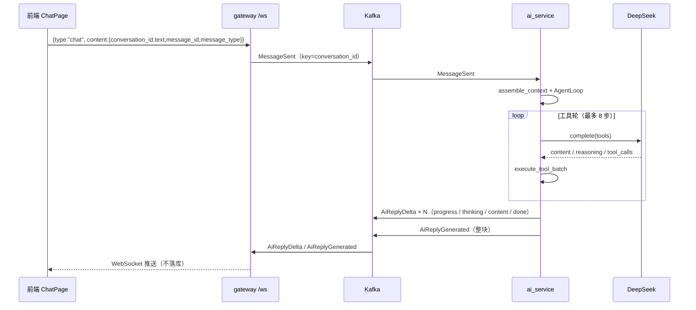

# 消息链路与字段传递文档

> 本文档描述**当前代码实际运行**的链路：前端 → gateway → Kafka → ai_service → Kafka → gateway → 前端。
>
> **当前没有消息落库**：storage 尚未实现，刷新页面后历史会丢失。存储现状见
> [storage-architecture.md](./storage-architecture.md)。
>
> 2026-11 重构后：私聊/群聊/深度模式已删除；`chat_service` 是 AI-only gateway；
> `ai_service` 是 AgentLoop harness；LLM 只有 `complete()` 调用，没有 token 级流式。

## 1. 总链路



> `AiReplyDelta` 是**答案生成完之后**再切块发送的，不是边生成边推送；
> 作用只是让前端能按块渲染，首字延迟等于整段回答的生成时间。

## 2. 前端 → gateway（WebSocket）

外层结构见 [ws_message.go](../services/chat_service/app/api/models/ws_message.go)：

```json
{
  "type": "chat",
  "content": {
    "conversation_id": "AI 会话 ID，可空",
    "text": "消息文本",
    "message_id": "客户端生成的 UUID，可空",
    "message_type": "text"
  }
}
```

| 字段 | 类型 | 说明 |
| --- | --- | --- |
| `type` | string | `chat` / `ping` |
| `content.conversation_id` | string | 为空时 gateway 生成 UUID |
| `content.text` | string | 消息正文；为空直接丢弃 |
| `content.message_id` | string | 为空时 gateway 生成 UUID |
| `content.message_type` | string | 默认 `text` |

前端 [ChatPage.tsx](../front_code/src/pages/ChatPage.tsx) 在发送后**本地乐观追加**用户消息；
gateway 不会把用户消息回推给发送者。

WebSocket 地址：`/api/v1/ws?token=<access_token>`（浏览器 WS 不能带 Header，
鉴权中间件支持 query token 回退）。

## 3. gateway（chat_service）

路由见 [router.go](../services/chat_service/app/api/routes/router.go)：

| 接口 | 说明 |
| --- | --- |
| `GET /api/v1/health` | 健康检查 |
| `GET /api/v1/users/:user_id` | 代理到 auth_service（gRPC），gateway 不查库 |
| `POST /api/v1/conversations` | 只返回一个新 UUID，不落库 |
| `GET /api/v1/ws` | WebSocket 入口 |

收到 `chat` 后（[chat_message_service.go](../services/chat_service/app/services/chat_message_service.go)）：

1. `text` 为空则丢弃；
2. 补全 `conversation_id` / `message_id` / `message_type`；
3. 构造 `MessageSent`，`target_user_id = config.AIUserID`（默认 `ai-assistant`）；
4. 发 Kafka，key 为 `conversation_id`，event type `chant.chat.v1.MessageSent`。

gateway **不写任何数据库**。

## 4. Kafka

Topic：`chat_group_message`。

信封定义见 [envelope.proto](../proto/chant/common/v1/envelope.proto)：

| 字段 | 说明 |
| --- | --- |
| `event_id` | 事件 ID |
| `event_type` | `chant.chat.v1.MessageSent` / `AiReplyDelta` / `AiReplyGenerated` |
| `source` | `chat-service` / `ai-service` |
| `timestamp` | 事件时间（Unix 毫秒） |
| `data` | protojson 序列化后的载荷 |

分区 key：

- `MessageSent`：`conversation_id`
- `AiReplyDelta` / `AiReplyGenerated`：`target_user_id`（保证同一条回复的分块与最终消息同分区有序）

> 用户消息与 AI 回复可能落在不同分区；如果以后有 storage 消费者，落库后必须按
> `timestamp_ms` 排序，不能依赖到达顺序。

## 5. MessageSent

定义见 [event.proto](../proto/chant/chat/v1/event.proto)。

| 字段 | 说明 |
| --- | --- |
| `sender_id` | 发送者用户 ID |
| `target_user_id` | AI 用户 ID，固定 `ai-assistant` |
| `conversation_id` | AI 会话 ID |
| `content` | 文本正文 |
| `message_id` | 消息 ID |
| `message_type` | `text` 等 |
| `timestamp_ms` | 毫秒时间戳 |
| `metadata` | 扩展字段（当前为空） |

## 6. ai_service 消费

[main.py](../services/ai_service/main.py)：

- consumer group：`ai_service_group`；
- **拉取与处理解耦**：`consume_loop` 只做 `parse + 入有界队列`，
  `ai_worker_count`（默认 8）个 worker 并发处理；
- 同一 `conversation_id` 串行（Kafka key 就是 conversation_id），不同会话并行；
- `auto_offset_reset=latest`、自动提交（自动提交是阶段一，见第 11 节）；
- 只处理 `MessageSent`，且 `target_user_id == settings.ai_user_id`；
- `AiReplyGenerated` 直接忽略，避免自己回复自己。

[apps/chat/service.py](../services/ai_service/apps/chat/service.py) 的处理：

1. 每个任务建一个 `Toolbox`（`user_id` / `conversation_id` / `message_id`）；
2. `system_prompt = SYSTEM_PROMPT + toolbox.catalog()`；
3. `assemble_context(...)` 组装上下文（**当前 history 传空数组**，见第 7 节）；
4. 先发一条 `progress="正在思考…"`；
5. 跑 `AgentLoop.run()`；
6. 把完整结果切块发 `AiReplyDelta`（thinking 64 字/块，content 16 字/块），最后发 `done`；
7. 发 `AiReplyGenerated`（整块，`metadata.reasoning` 带思考全文）；
8. 成本写 PostgreSQL（失败只告警）。

## 7. 上下文组装

[memory/context.py](../services/ai_service/memory/context.py)：

- 模型看到的上下文 = 系统提示 + 折叠摘要 + 检查点之后的尾巴 + 当前消息；
- 超过“上下文窗口 × 0.8”时把旧段摘要化，保留约 16% 原文尾巴；
- 检查点 `{conversation_id, watermark_ms, summary, updated_at_ms}`。

**当前实际行为**：调用方传的 history 是空数组，所以只有“系统提示 + 当前消息”，
折叠逻辑不会触发。检查点目前直连 Mongo，是 storage 接入前的临时实现。

## 8. AgentLoop

[runtime/agent_loop](../services/ai_service/runtime/agent_loop/loop.py)：

```
model.complete(messages, tools)
  ├─ 无 tool_calls → 最终回答，结束
  └─ 有 tool_calls → 追加 assistant + tool 结果 → 再请求
        └─ 超过预算 → 追加“直接回答”提示，做一次无工具调用收口
```

预算（[config.py](../services/ai_service/runtime/agent_loop/config.py)）：

| 配置 | 默认 | 说明 |
| --- | --- | --- |
| `max_steps` | 8 | 最多模型调用次数 |
| `max_tool_calls` | 16 | 任务内工具调用上限（批次执行后检查） |
| `max_seconds` | 120 | 步骤之间检查的软时间预算 |
| `tool_timeout_seconds` | 30 | 单个工具超时 |
| `max_parallel_tools` | 5 | 同批工具并发上限 |
| `max_tool_result_chars` | 8000 | 单条工具结果截断，保留头尾 |

工具执行（[executor.py](../services/ai_service/runtime/agent_loop/executor.py)）：

- `load_tools` 先串行执行（屏障），其余工具并行；
- 结果按模型返回顺序回填；
- 未知工具、未加载、参数错误、异常、超时都会变成一条 tool 消息，保证 call/result 配对。

可用工具（[llm_tools](../services/ai_service/llm_relay/llm_tools/__init__.py)）：
`load_tools`（常驻）、`get_current_time`、`web_search`、`web_fetch`。
后两个走 DeepSeek `/tools/search`、`/tools/fetch`。

## 9. AI 回复事件

### AiReplyDelta

定义见 [event.proto](../proto/chant/chat/v1/event.proto)。

| 字段 | 说明 |
| --- | --- |
| `sender_id` | `ai-assistant` |
| `target_user_id` | 回复给谁 |
| `conversation_id` | 会话 ID |
| `reply_to_msg_id` | 回复的用户消息 ID |
| `message_id` | `ai-<用户消息 ID>`，该回复所有分块一致 |
| `seq` | 从 0 递增 |
| `kind` | `progress` / `thinking` / `content` / `done` |
| `content` | 增量文本；`done` 为空 |

### AiReplyGenerated

| 字段 | 说明 |
| --- | --- |
| `sender_id` | `ai-assistant` |
| `target_user_id` | 回复给谁 |
| `conversation_id` | 会话 ID |
| `content` | 完整回答 |
| `reply_to_msg_id` | 回复的用户消息 ID |
| `message_id` | `ai-<用户消息 ID>` |
| `metadata` | `reasoning`：思考全文 |
| `timestamp_ms` | 毫秒时间戳 |

错误路径：`send_error_reply` 发送固定兜底文案，`message_id = ai-err-<用户消息 ID>`，
`reply_to_msg_id` 仍是原消息，前端据此清掉未收尾的流式条目。

## 10. gateway 消费并推送

[event_consumer.go](../services/chat_service/app/infrastructure/kafka/event_consumer.go)：

- `AiReplyDelta` → `BroadcastAiReplyDelta`；
- `AiReplyGenerated` → `BroadcastAiReply`；
- 只推给 `target_user_id` 的本地 WS 连接，**不落库**。

WS 推送 JSON（[event_handlers.go](../services/chat_service/app/infrastructure/kafka/services/event_handlers.go)）：

```json
{
  "type": "ai_chat",
  "conversation_id": "...",
  "sender": "ai-assistant",
  "content": "...",
  "message_id": "ai-...",
  "reply_to_msg_id": "...",
  "metadata": { "reasoning": "..." },
  "kind": "content",
  "seq": 3,
  "time": 1786000000000
}
```

## 11. 当前限制（已知）

1. **没有持久化**：用户消息、AI 回复、会话列表都不落库；刷新即丢。
2. **短期记忆空转**：history 恒为空，折叠逻辑不会触发。
3. **自动提交**：已改为 8 个 worker 并发（同一会话串行），但仍是
   `enable_auto_commit=True`；进程崩溃/取消时，队列里未处理的消息可能已被提交而丢失；
   `auto_offset_reset=latest` 也会丢停机期间的消息。下一阶段改手动提交 + 幂等。
4. **无幂等**：Kafka 重投会重复回复同一 `message_id`。
5. **无 token 预算**：只有步数/工具数/时间预算；工具结果按单条 8000 字符截断，
   多轮后仍可能超出上下文窗口。
6. **工具目录是快照**：`load_tools` 之后 system prompt 里的目录不会刷新。
7. **没有 token 级流式**：`AiReplyDelta` 是完整答案生成后的切块。

## 12. 配置位置

| 位置 | 内容 |
| --- | --- |
| `services/chat_service/config.yaml` | gateway 端口、Kafka、AI 用户 ID、CORS/WS Origin |
| `services/ai_service/llm_relay/config/config.json` | provider / model / routing / 价格 / 超时 / web 工具 |
| `services/ai_service/.env.example` | Kafka、成本库、记忆检查点、密钥 |
| `docker-compose.yml` | 开发：基础设施 + auth + gateway + orchestrator |
| `docker-compose.prod.yml` | 生产：含 ai-service |
| `docker-compose.ai.yml` | 独立 AI 节点 |
| `docker-compose.chat.yml` | 独立 gateway 节点 |
| `docker-compose.edge.yml` | 独立 auth/nginx 节点 |
